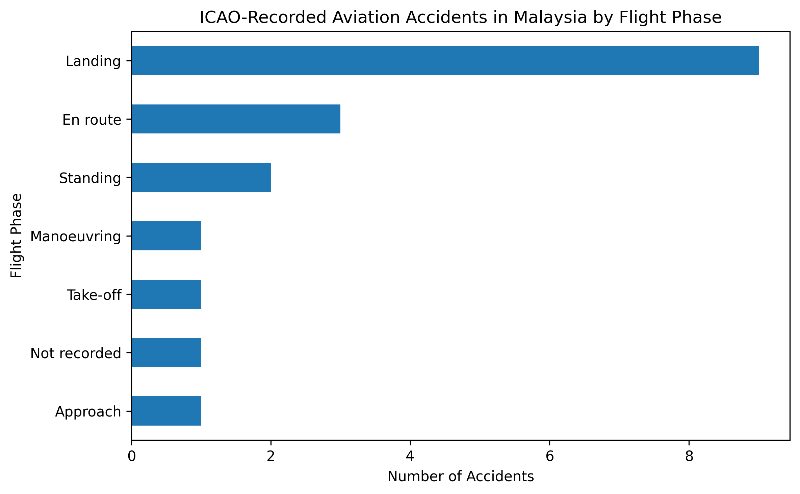
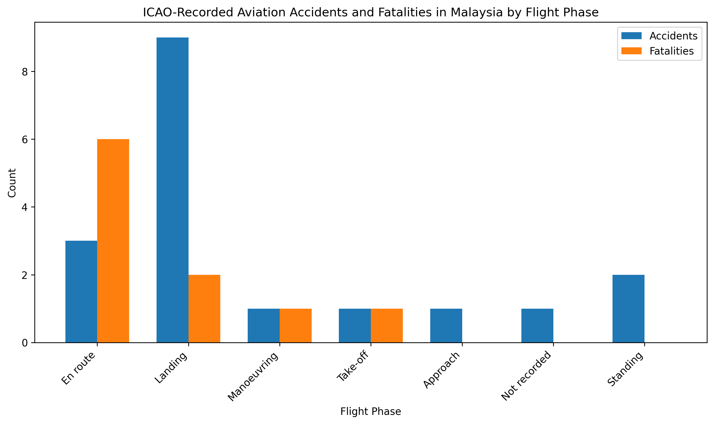
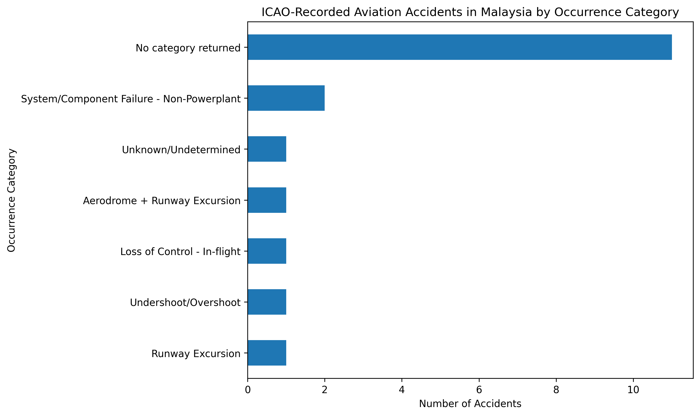

# Malaysia Aviation Safety Analysis

A reproducible exploratory analysis of ICAO-recorded aviation accidents in Malaysia, with emphasis on accident frequency, flight phase, recorded fatalities, and occurrence categories.

## Objective

This project explores aviation accident records returned by the ICAO API for Malaysia and examines two safety questions:

1. During which flight phases were accidents most frequently recorded?
2. Did the flight phases with the highest accident frequency also account for the highest number of fatalities?

The analysis demonstrates an important safety principle: accident frequency and accident severity do not necessarily follow the same pattern.

## Data Source

Data were retrieved through the International Civil Aviation Organization (ICAO) API Data Service.

The query returned 18 accident records for Malaysia covering the period from 2008 to 2019.

The dataset contained information including:

- Date
- Location
- Aircraft model
- Operator
- Flight phase
- Accident class
- Fatalities
- Injury level
- Occurrence category
- Risk information
- Year

## Data Cleaning

Several preprocessing steps were applied before analysis.

Blank flight-phase values were labelled as `Not recorded`.

Empty occurrence-category responses were labelled as `No category returned`.

The `Fatalities` field was converted from text to numeric format before statistical aggregation.

Two ICAO records had missing fatality values. These records were cross-checked against official Malaysian accident investigation records before creating a separate verified fatality field for analysis.

The original ICAO values were retained separately rather than silently overwritten.

## Key Findings

### 1. Landing was the most frequently recorded accident phase

Of the 18 accident records returned by the ICAO API:

- 9 occurred during landing
- 3 occurred en route
- 2 occurred while standing
- 1 occurred during approach
- 1 occurred during manoeuvring
- 1 occurred during take-off
- 1 had no recorded flight phase

Landing therefore represented **50% of the accident records in this dataset**.

This should not be interpreted as meaning that 50% of all aviation accidents in Malaysia occur during landing. The result applies only to the records returned by this particular ICAO API query.

## 2. Accident frequency and fatality severity differed

Landing recorded the highest number of accidents but did not account for the largest number of fatalities.

| Flight Phase | Accidents | Recorded Fatalities |
| --- | ---: | ---: |
| En route | 3 | 6 |
| Landing | 9 | 2 |
| Manoeuvring | 1 | 1 |
| Take-off | 1 | 1 |
| Approach | 1 | 0 |
| Standing | 2 | 0 |
| Not recorded | 1 | 0 |

The en-route phase accounted for the highest number of recorded fatalities despite representing only three accident records.

This illustrates a basic HSE and safety-risk concept:

> Frequency and severity should be evaluated separately when prioritizing safety risks.

A hazard or operational phase that produces fewer events may still result in more severe consequences.

## Occurrence Categories

The dataset included occurrence categories such as:

- System/Component Failure – Non-Powerplant
- Undershoot/Overshoot
- Runway Excursion
- Aerodrome
- Loss of Control – In-flight
- Unknown/Undetermined

However, 11 of the 18 records did not return an occurrence category.

Occurrence-category findings should therefore be interpreted cautiously because of substantial category-data incompleteness.

## Visualizations

### Accidents by Flight Phase

### Accident Frequency vs Fatalities

### Occurrence Categories

## Reproducing the Analysis

The complete workflow is available in:

`icao_aviation_safety_analysis.ipynb`

To reproduce the analysis:

1. Obtain an ICAO API key.
2. Open the notebook in Google Colab or Jupyter Notebook.
3. Enter the API key when prompted.
4. Run the ICAO API query for Malaysia.
5. Convert the returned JSON data into a Pandas DataFrame.
6. Clean the required variables.
7. Run the descriptive analysis and visualization cells.

The API key is intentionally not stored in the repository.

## Files

`icao_aviation_safety_analysis.ipynb`  
Contains the complete API retrieval, data cleaning, analysis, and visualization workflow.

`malaysia_icao_accidents_cleaned.csv`  
Contains the cleaned dataset used for analysis.

`fatalities_by_flight_phase.csv`  
Contains the summarized accident and fatality counts by flight phase.

`malaysia_accidents_by_flight_phase.png`  
Shows accident frequency across flight phases.

`accidents_vs_fatalities_by_flight_phase.png`  
Compares accident frequency with recorded fatalities.

`malaysia_accidents_by_occurrence_category.png`  
Shows the occurrence categories returned by the ICAO dataset.

## Tools

- Python
- Pandas
- Matplotlib
- Requests
- Google Colab
- ICAO API Data Service

## Limitations

This project is an exploratory analysis of records returned by a specific ICAO API query.

Important limitations include:

- Only 18 accident records were returned.
- The dataset covers 2008–2019 rather than all historical Malaysian aviation accidents.
- Occurrence-category information was missing for many records.
- Two fatality values required independent verification.
- Accident counts alone do not represent exposure-based risk.
- No denominator such as number of flights, flight hours, or passenger movements was available.

The results therefore describe patterns within this dataset and should not be interpreted as national accident rates or causal evidence.

## Author

PenguinLogic
